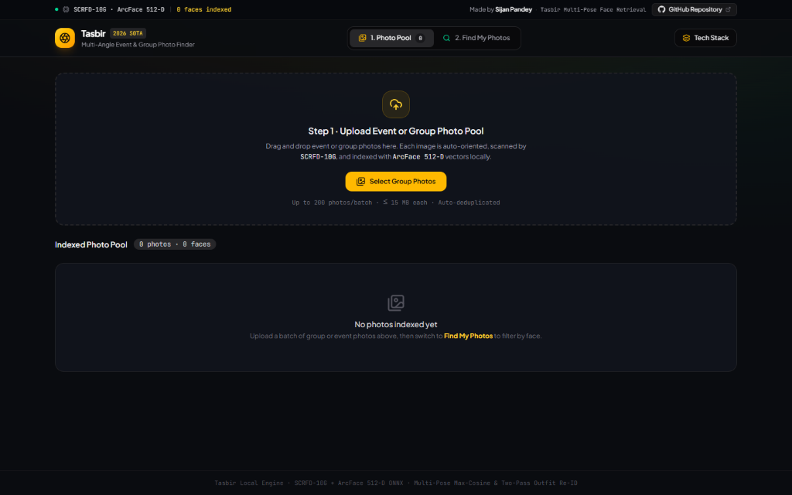
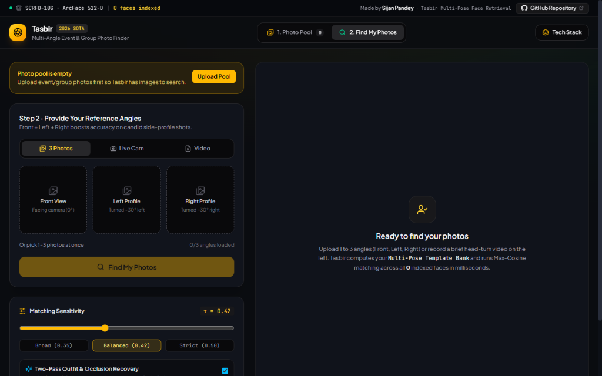
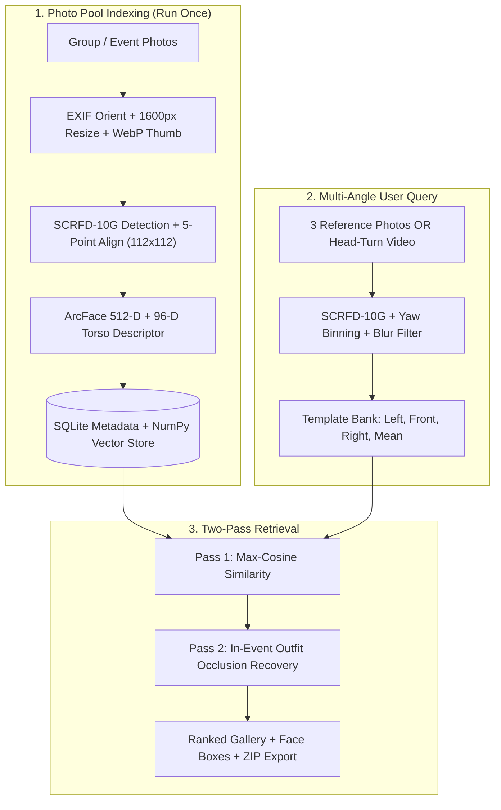
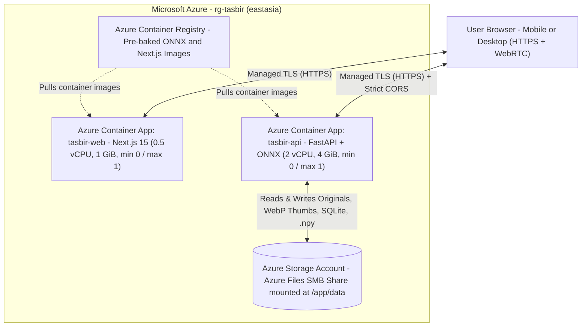

# Tasbir — Multi-Pose Event & Group Photo Retrieval


> [!TIP]
> ### Try Tasbir Live — Hosted on Microsoft Azure
> [](https://tasbir-web.kindbush-f7946e21.eastasia.azurecontainerapps.io)
> [](https://tasbir-api.kindbush-f7946e21.eastasia.azurecontainerapps.io/docs)
>
> **Direct Link:** **https://tasbir-web.kindbush-f7946e21.eastasia.azurecontainerapps.io**  
> *(Runs on scale-to-zero Azure Container Apps with automatic HTTPS so WebRTC live webcam capture works on mobile and desktop. First load after idle takes ~10–15 seconds to wake up.)*

**Tasbir** is a zero-training, full-stack Computer Vision web application—**live and hosted on Microsoft Azure**—that retrieves every photo containing a specific person from large event or group photo collections using **multi-angle reference selfies (Left, Front, Right)** or a **short head-turn video**.

Powered by a pure-ONNX **SCRFD-10G** detector, 5-point similarity alignment, **ArcFace ResNet-50 (WebFace600K)** 512-D embeddings, **Multi-Pose Max-Cosine matching**, and **Two-Pass In-Event Outfit Re-ID** for occlusion recovery.

---

## UI Preview

### 1. Photo Pool (Bulk Upload & Indexing)


### 2. Find My Photos (3-Angle / Webcam / Video Matching)


**How to try it out in 30 seconds:**
1. Open **[Tasbir Live on Azure](https://tasbir-web.kindbush-f7946e21.eastasia.azurecontainerapps.io)**.
2. On **1. Photo Pool**, drag and drop a batch of group or event photos to detect and index all faces.
3. Switch to **2. Find My Photos**, upload 1–3 angles of one person (or use **Live Cam** / **Video**), and click **Find My Photos** to view ranked matches with bounding-box overlays and one-click `.zip` download.

---

## Key Capabilities

- **Zero-Training Open-Set Retrieval:** Works immediately on unseen people without collecting training datasets or retraining classifiers per user.
- **Multi-Angle Reference Enrollment (3 Modes):**
  - Upload **1–3 reference photos** (`Front`, `Left Profile`, `Right Profile`).
  - Capture live via **in-browser WebRTC webcam** (guided 3-angle snapshots or 4.5-second head-turn video over Azure HTTPS).
  - Upload a **3–12s head-turn video** (`.mp4`, `.webm`, `.mov`) with automated 5-point yaw estimation and Laplacian sharpness frame selection.
- **Multi-Pose Template Bank (`Max-Cosine`):** Stores individual pose vectors plus their normalized centroid so candid side-profile photos match strongly without frontal averaging washout.
- **Two-Pass Outfit & Occlusion Recovery:** Uses high-confidence Pass-1 matches from the same event to build an in-event face + torso outfit anchor, recovering partially occluded or sunglasses shots in Pass 2.
- **Production Cloud & Gallery UX:** Deployed on Microsoft Azure with persistent **Azure Files** storage, EXIF auto-orientation, SHA-256 duplicate protection, `1600px` in-memory detection scaling, `480px` WebP thumbnails, full-resolution lightbox with SCRFD bounding-box overlays, and one-click `.zip` export.

---

## System Pipeline



### Matching Formulation

Given $L_2$-normalized reference embeddings and an indexed face embedding $\mathbf{f} \in \mathbb{R}^{512}$:

```math
\mathcal{T} = \lbrace \mathbf{e}_{\text{left}},\; \mathbf{e}_{\text{front}},\; \mathbf{e}_{\text{right}},\; \mathbf{e}_{\text{mean}} \rbrace
```

**Pass 1 — Max-Over-Templates Cosine Similarity** (default $\tau = 0.42$):

```math
S_{\text{face}}(\mathbf{f}) = \max_{k \in \mathcal{T}} (\mathbf{f} \cdot \mathbf{e}_k) \ge \tau
```

**Pass 2 — In-Event Outfit Recovery (for borderline or occluded faces):**  
High-confidence Pass-1 anchors ($S_{\text{face}} \ge 0.50$) define an event-specific face anchor and torso descriptor. Borderline faces ($0.25 \le S_{\text{face}} < \tau$) are rescored via:

```math
S_{\text{combined}} = 0.65 \cdot S_{\text{event}} + 0.35 \cdot S_{\text{outfit}}
```

---

## Cloud Implementation (Microsoft Azure)

Tasbir is fully containerized and deployed on **Microsoft Azure** (`rg-tasbir`, region `eastasia`) using a serverless scale-to-zero architecture designed for fast cold starts, persistent photo/vector storage, and near-zero idle cost.



### Deployed Azure Resource Topology

| Resource | Service & SKU | Configuration & Purpose |
| :--- | :--- | :--- |
| **Compute Environment** | `Azure Container Apps` (`WorkloadProfiles` Consumption) | Serverless container hosting with managed HTTPS ingress, Log Analytics, and Azure Files volume support |
| **Frontend Service (`tasbir-web`)** | Container App (`0.5 vCPU`, `1.0 GiB`, `min 0 / max 1`) | Multi-stage `node:20-alpine` image (`output: "standalone"`), built with `NEXT_PUBLIC_API_URL` targeting the live API |
| **Backend Service (`tasbir-api`)** | Container App (`2.0 vCPU`, `4.0 GiB`, `min 0 / max 1`) | `python:3.11-slim` image with `SCRFD-10G` + `ArcFace` ONNX models pre-baked at build time for `<1s` startup |
| **Container Registry** | `Azure Container Registry` (`Basic`) | Stores versioned `linux/amd64` Docker images built locally and pushed via [`deploy-azure.ps1`](deploy-azure.ps1) |
| **Persistent Storage** | `Azure Storage` (`Standard_LRS`) + `Azure Files` (`5 GiB`) | Mounted at `/app/data` on `tasbir-api` so uploaded photos, WebP thumbnails, SQLite DB, and `.npy` vectors persist across restarts |

### Key Cloud Engineering Details

- **Pre-Baked ONNX Weights for Fast Cold Starts:** Both `det_10g.onnx` (`SCRFD-10G`, 16.9 MB) and `w600k_r50.onnx` (`ArcFace ResNet-50`, 174 MB) are downloaded during `backend/Dockerfile` build rather than at container boot—eliminating startup download latency so Uvicorn starts in under 1 second.
- **SQLite Persistence over Azure Files (SMB/CIFS):** Azure Files SMB mounts reject POSIX `fcntl` byte-range locks used by default SQLite journaling (`OperationalError: database is locked`). In cloud mode (`TASBIR_SQLITE_NOLOCK=true`), `PhotoPoolStore` opens SQLite with URI `?nolock=1` and `PRAGMA journal_mode = MEMORY`, while serializing all writes through an in-process `threading.RLock` paired with `max-replicas: 1`. Embedding arrays (`.npy`) are persisted via temp-file atomic `replace`.
- **Automatic HTTPS & WebRTC Unlock:** Azure Container Apps provisions managed TLS certificates automatically, enabling browser `getUserMedia` / `MediaRecorder` webcam capture on both desktop and mobile devices.
- **Strict Cross-Origin Security:** `tasbir-api` dynamically parses `TASBIR_CORS_ORIGINS` (supporting comma-separated origins or JSON arrays) so only the deployed `tasbir-web` HTTPS origin (and local dev) can call the API.
- **Repeatable Infrastructure Script:** All provisioning, Docker `linux/amd64` builds, ACR pushes, Azure Files volume YAML mounts, and CORS wiring are scripted in [`deploy-azure.ps1`](deploy-azure.ps1).

---

## Tech Stack

| Layer | Technologies |
| :--- | :--- |
| **AI & Computer Vision** | `ONNX Runtime`, `SCRFD-10G` (`det_10g.onnx`), `ArcFace ResNet-50` (`w600k_r50.onnx`, 512-D), `OpenCV`, `NumPy`, `Pillow` |
| **Backend API** | `Python 3.11+`, `FastAPI`, `Uvicorn`, `Pydantic v2` |
| **Frontend Web App** | `Next.js 15` (App Router), `React 19`, `TypeScript`, `Tailwind CSS v4`, `WebRTC` (`getUserMedia` / `MediaRecorder`), `Lucide Icons` |
| **Cloud & Infrastructure** | `Microsoft Azure Container Apps`, `Azure Container Registry (ACR)`, `Azure Files`, `Docker`, `Docker Compose` |
| **Storage & Testing** | `SQLite`, atomic `.npy` vector persistence, `Pytest`, `HTTPX` |

---

## Quickstart

### Prerequisites
- **Python 3.11+** (with [`uv`](https://docs.astral.sh/uv/) or `pip`)
- **Node.js 20+** and `npm`

### 1. Install Dependencies

**Backend (`backend/`):**
```powershell
cd backend
uv venv --python 3.11 .venv
uv pip install --python .venv\Scripts\python.exe -r requirements.txt
```
*(Or with standard `pip`: `python -m venv .venv && .\.venv\Scripts\pip install -r requirements.txt`)*

**Frontend (`frontend/`):**
```powershell
cd frontend
npm install
```

### 2. Run Locally

**One-Command Launch (Windows PowerShell):**
```powershell
.\start.ps1
```

**Or run in two terminals:**
```powershell
# Terminal 1 — Backend API (auto-downloads SCRFD-10G + ArcFace ONNX on first start)
cd backend
.\.venv\Scripts\uvicorn.exe app.main:app --host 127.0.0.1 --port 8000 --reload

# Terminal 2 — Web Frontend
cd frontend
npm run dev
```

- **Web Application:** `http://localhost:3000`
- **Interactive API Docs (Swagger):** `http://localhost:8000/docs`

### 3. Run Automated Tests

```powershell
cd backend
$env:PYTHONPATH="."
.\.venv\Scripts\pytest.exe -v tests/test_pipeline.py
```

### 4. Run with Docker Compose or Deploy to Azure

**Local Docker Compose:**
```powershell
docker compose up --build
```

**Deploy / Redeploy to Microsoft Azure Container Apps (`eastasia`):**
```powershell
.\deploy-azure.ps1
```
Provisions `Azure Container Registry`, `Azure Files` persistent storage (`/app/data`), and scale-to-zero `tasbir-api` + `tasbir-web` Container Apps with automatic HTTPS and CORS wiring.

---

## REST API Reference

| Method & Endpoint | Description |
| :--- | :--- |
| `GET /api/health` | Returns model specs (`SCRFD-10G`, `ArcFace`), ONNX provider, limits, and pool stats |
| `GET /api/pool` | Lists all indexed photos with WebP thumbnail URLs and SCRFD face boxes |
| `POST /api/pool/upload` | Bulk indexes up to 200 photos/batch (`<= 15 MB` each), deduplicating by SHA-256 |
| `DELETE /api/pool/{id}` / `DELETE /api/pool` | Removes one photo (compacting vector indices) or clears the entire pool |
| `POST /api/match/photos` | Matches 1–5 reference photos with configurable `threshold` and `enable_pass2` |
| `POST /api/match/video` | Extracts sharpest Left/Front/Right frames from a head-turn video and runs matching |
| `POST /api/download-zip` | Streams a `.zip` archive of full-resolution originals for matched `photo_ids` |

---

## Repository Structure

```text
.
├── README.md                          # Project overview, architecture & quickstart
├── start.ps1                          # One-command local launcher (backend + frontend)
├── deploy-azure.ps1                   # One-command Azure Container Apps deploy script
├── docker-compose.yml                 # Local full-stack Docker Compose setup
├── docs/
│   ├── STUDY_GUIDE.md                 # CV concepts, interview notes & paper references
│   └── screenshots/                   # UI screenshots embedded in README
├── backend/
│   ├── app/
│   │   ├── config.py                  # Storage paths, upload guardrails & thresholds
│   │   ├── db.py                      # SQLite metadata + atomic .npy vector persistence
│   │   ├── vision.py                  # Pure-ONNX SCRFD-10G, 5-pt alignment, ArcFace, yaw & blur
│   │   ├── matcher.py                 # Multi-Pose Max-Cosine + Pass-2 Outfit Re-ID engine
│   │   └── main.py                    # FastAPI server & static media serving
│   ├── tests/
│   │   └── test_pipeline.py           # Pytest suite (DB, matcher, ONNX models, FastAPI)
│   └── requirements.txt
└── frontend/                          # Next.js 15 (TypeScript) + Tailwind CSS v4
    └── src/
        ├── lib/api.ts                 # Typed REST client
        ├── app/page.tsx               # Studio shell & live telemetry header
        └── components/
            ├── PoolPanel.tsx          # Bulk drag-and-drop uploader & indexed gallery
            ├── FinderPanel.tsx        # 3-angle photos, live webcam & video matching UI
            ├── WebcamCapture.tsx      # Guided 3-shot & 4.5s WebRTC head-turn recorder
            └── PhotoLightbox.tsx      # Full-res viewer with SCRFD bounding-box overlays
```

---

## Documentation & Enterprise Scale-Up Path

- **Deep-Dive Notes & Papers:** See [docs/STUDY_GUIDE.md](docs/STUDY_GUIDE.md) for mathematical intuition behind `SCRFD`, `ArcFace`, `AdaFace`, yaw binning, and occlusion handling.
- **Scaling Beyond 50,000+ Faces:** The current live deployment runs on **Azure Container Apps + ACR + Azure Files** with SQLite and NumPy. For multi-tenant, high-concurrency event platforms, swap the storage adapter to **Azure Database for PostgreSQL + `pgvector` (HNSW)**, **Azure Blob Storage** (SAS URLs), and **Azure Storage Queues** for distributed worker pools.

---

## Author

Made by **Sijan Pandey** — [Live Azure App](https://tasbir-web.kindbush-f7946e21.eastasia.azurecontainerapps.io) · [GitHub Repository](https://github.com/devsijanpandey12/Tasbir---Multi-Pose-Face-Retrieval-)
