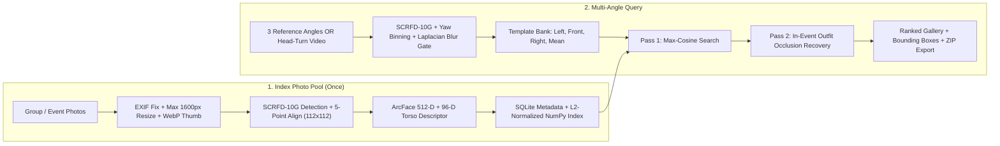

# Tasbir — Multi-Pose Event & Group Photo Retrieval


**Tasbir** is a zero-training, full-stack Computer Vision web application that retrieves every photo containing a specific person from large event or wedding albums using **multi-angle reference selfies (Left, Front, Right)** or a **short head-turn video**.

Powered by a pure-ONNX **SCRFD-10G** detector, 5-point similarity alignment, **ArcFace ResNet-50 (WebFace600K)** 512-D embeddings, **Multi-Pose Max-Cosine matching**, and **Two-Pass In-Event Outfit Re-ID** for occlusion recovery.

---

## Key Capabilities

- **Zero-Training Open-Set Retrieval:** Works immediately on unseen people without collecting training datasets or retraining classifiers per user.
- **Multi-Angle Reference Enrollment (3 Modes):**
  - Upload **1–3 reference photos** (`Front`, `Left Profile`, `Right Profile`).
  - Capture live via **in-browser WebRTC webcam** (guided 3-angle snapshots or 4.5-second head-turn video).
  - Upload a **3–12s head-turn video** (`.mp4`, `.webm`, `.mov`) with automated 5-point yaw estimation and Laplacian sharpness frame selection.
- **Multi-Pose Template Bank (`Max-Cosine`):** Stores individual pose vectors plus their normalized centroid so candid side-profile event photos match strongly without frontal averaging washout.
- **Two-Pass Outfit & Occlusion Recovery:** Uses high-confidence Pass-1 matches from the same event to build an in-event face + torso outfit anchor, recovering partially occluded or sunglasses shots in Pass 2.
- **Production-Ready Local UX:** EXIF auto-orientation, SHA-256 duplicate protection, `1600px` in-memory detection scaling, `480px` WebP thumbnails, full-resolution lightbox with SCRFD bounding-box overlays, and one-click `.zip` export of matched originals.

---

## System Pipeline



### Matching Formulation

Given $L_2$-normalized reference embeddings $\mathcal{T} = \{\mathbf{e}_{\text{left}}, \mathbf{e}_{\text{front}}, \mathbf{e}_{\text{right}}, \mathbf{e}_{\text{mean}}\}$ and an indexed face embedding $\mathbf{f} \in \mathbb{R}^{512}$:

- **Pass 1 (Max-Over-Templates Cosine Similarity):**
  $$S_{\text{face}}(\mathbf{f}) = \max_{k \in \mathcal{T}} (\mathbf{f} \cdot \mathbf{e}_k) \ge \tau \quad (\text{default } \tau = 0.42)$$
- **Pass 2 (In-Event Outfit Recovery for borderline/occluded faces):**
  High-confidence Pass-1 anchors ($S_{\text{face}} \ge 0.50$) define an event-specific face anchor and torso descriptor. Borderline faces ($0.25 \le S_{\text{face}} < \tau$) are rescored via:
  $$S_{\text{combined}} = 0.65 \cdot S_{\text{face\_event}} + 0.35 \cdot S_{\text{outfit}}$$

---

## Technical Evolution (Reaco 2024 $\rightarrow$ Tasbir 2026)

| Component | Original 2024 Proposal (`Reaco`) | 2026 Implementation (`Tasbir`) |
| :--- | :--- | :--- |
| **Detection & Alignment** | YOLOv8m + Dlib 68 landmarks | **SCRFD-10G (`det_10g.onnx`)** joint box + 5-point similarity alignment |
| **Face Embeddings** | Custom InceptionV3 Siamese (Triplet Loss, `128x128`) | Pre-trained **ArcFace ResNet-50 (`w600k_r50.onnx`, `512-D`)** |
| **Matching Engine** | Per-user KNN / SVM retraining | **Multi-Pose Max-Cosine** dot product + **Two-Pass Outfit Re-ID** |
| **Inference Runtime** | TensorFlow / Keras | Pure **ONNX Runtime** (no C++/Cython build requirements) |
| **Interface & Storage** | Flutter + raw images in MongoDB | **Next.js 15 + FastAPI** + local originals/WebP thumbs + SQLite/NumPy |

---

## Quickstart

### Prerequisites
- **Python 3.11+** (with [`uv`](https://docs.astral.sh/uv/) or `pip`)
- **Node.js 20+** and `npm`

### 1. Install Dependencies

**Backend (`backend/`):**
```powershell
cd backend
uv venv --python 3.11 .venv
uv pip install --python .venv\Scripts\python.exe -r requirements.txt
```
*(Or with standard `pip`: `python -m venv .venv && .\.venv\Scripts\pip install -r requirements.txt`)*

**Frontend (`frontend/`):**
```powershell
cd frontend
npm install
```

### 2. Run Locally

**One-Command Launch (Windows PowerShell):**
```powershell
.\start.ps1
```

**Or run in two terminals:**
```powershell
# Terminal 1 — Backend API (auto-downloads SCRFD-10G + ArcFace ONNX on first start)
cd backend
.\.venv\Scripts\uvicorn.exe app.main:app --host 127.0.0.1 --port 8000 --reload

# Terminal 2 — Web Frontend
cd frontend
npm run dev
```

- **Web Application:** `http://localhost:3000`
- **Interactive API Docs (Swagger):** `http://localhost:8000/docs`

### 3. Run Automated Tests

```powershell
cd backend
$env:PYTHONPATH="."
.\.venv\Scripts\pytest.exe -v tests/test_pipeline.py
```

---

## REST API Reference

| Method & Endpoint | Description |
| :--- | :--- |
| `GET /api/health` | Returns model specs (`SCRFD-10G`, `ArcFace`), ONNX provider, limits, and pool stats |
| `GET /api/pool` | Lists all indexed photos with WebP thumbnail URLs and SCRFD face boxes |
| `POST /api/pool/upload` | Bulk indexes up to 200 photos/batch (`<= 15 MB` each), deduplicating by SHA-256 |
| `DELETE /api/pool/{id}` / `DELETE /api/pool` | Removes one photo (compacting vector indices) or clears the entire pool |
| `POST /api/match/photos` | Matches 1–5 reference photos with configurable `threshold` and `enable_pass2` |
| `POST /api/match/video` | Extracts sharpest Left/Front/Right frames from a head-turn video and runs matching |
| `POST /api/download-zip` | Streams a `.zip` archive of full-resolution originals for matched `photo_ids` |

---

## Repository Structure

```text
.
├── README.md                          # Project overview, architecture & quickstart
├── start.ps1                          # One-command local launcher (backend + frontend)
├── docs/
│   └── STUDY_GUIDE.md                 # CV concepts, interview notes & paper references
├── backend/
│   ├── app/
│   │   ├── config.py                  # Storage paths, upload guardrails & thresholds
│   │   ├── db.py                      # SQLite metadata + atomic .npy vector persistence
│   │   ├── vision.py                  # Pure-ONNX SCRFD-10G, 5-pt alignment, ArcFace, yaw & blur
│   │   ├── matcher.py                 # Multi-Pose Max-Cosine + Pass-2 Outfit Re-ID engine
│   │   └── main.py                    # FastAPI server & static media serving
│   ├── tests/
│   │   └── test_pipeline.py           # Pytest suite (DB, matcher, ONNX models, FastAPI)
│   └── requirements.txt
└── frontend/                          # Next.js 15 (TypeScript) + Tailwind CSS v4
    └── src/
        ├── lib/api.ts                 # Typed REST client
        ├── app/page.tsx               # Studio shell & live telemetry header
        └── components/
            ├── PoolPanel.tsx          # Bulk drag-and-drop uploader & indexed gallery
            ├── FinderPanel.tsx        # 3-angle photos, live webcam & video matching UI
            ├── WebcamCapture.tsx      # Guided 3-shot & 4.5s WebRTC head-turn recorder
            └── PhotoLightbox.tsx      # Full-res viewer with SCRFD bounding-box overlays
```

---

## Documentation & Cloud Scaling Roadmap

- **Deep-Dive Notes & Papers:** See [docs/STUDY_GUIDE.md](docs/STUDY_GUIDE.md) for mathematical intuition behind `SCRFD`, `ArcFace`, `AdaFace`, yaw binning, and occlusion handling.
- **Cloud Production Path (Phase 2):** Swap local SQLite + `.npy` for **PostgreSQL + `pgvector` (HNSW)**, replace local media directories with **Azure Blob Storage** (SAS URLs) + **Azure Storage Queues**, and deploy containerized FastAPI/ONNX workers on **Azure Container Apps** with the frontend on **Azure Static Web Apps**.
